<div align="center">



<br/>

[](https://git.io/typing-svg)

<p>
<a href="https://www.malt.fr/profile/leocouffinhal"></a>
<a href="https://qwetle.fr"></a>


</p>

</div>

---

### 👋 À propos

Développeur **full stack**, je conçois des applications web de bout en bout : de la base de données à l'interface, jusqu'au déploiement et à l'hébergement.

J'ai travaillé aussi bien en équipe produit sur des SaaS et des APIs à fort trafic qu'en indépendant sur des outils métier sur mesure, notamment pour le secteur de la santé et de la recherche. Ce qui me plaît : comprendre un métier, puis livrer un outil simple, fiable et maintenable.

```ts
const leo = {
  role: "Développeur Full Stack",
  stack: ["TypeScript", "React / Next.js", "Node", "PHP (Symfony / Laravel)", "PostgreSQL"],
  domaines: ["santé & recherche clinique", "outils métier", "jeux web"],
  sideQuests: ["self-hosting", "Stable Diffusion", "impression 3D"],
  debug: (bug?: Error) => (bug ? "docker compose down && docker compose up -d" : "ship it 🚀"),
};
```

---

### 🛠️ Stack

<p>

<br/><br/>

</p>

`REST` · `GraphQL` · `Swagger` · `Traefik` · `Dokploy` · `Portainer` · `MinIO` · `Let's Encrypt`

---

### 🚀 Projets phares

<table>
<tr>
<td width="50%" valign="top">

**[MediSync](https://github.com/Suissehide/MediSync)**
Application web dans le domaine de la santé.

`TypeScript`

</td>
<td width="50%" valign="top">

**[Gachapon](https://github.com/Suissehide/Gachapon)**
Jeu de cartes à collectionner façon gacha, avec des illustrations de fantasy médiévale générées par Stable Diffusion et une communauté Discord.

`TypeScript` `Stable Diffusion`

</td>
</tr>
<tr>
<td width="50%" valign="top">

**[Horus](https://github.com/Suissehide/Horus)**
Application de recueil de données pour une étude clinique sur les patients à haut risque cardio-vasculaire.

`PHP` `Symfony` `eCRF`

</td>
<td width="50%" valign="top">

**[Tools](https://github.com/Suissehide/Tools)**
Toute mon infra self-hosted dans un seul `docker-compose` à profils : Traefik v3, certificats wildcard, Dokploy, Portainer, Jellyfin…

`Docker` `Traefik` `DevOps`

</td>
</tr>
<tr>
<td width="50%" valign="top">

**[Trianglify](https://github.com/Suissehide/Trianglify)** ⭐ 10
Générateur gratuit de fonds d'écran low-poly.

`JavaScript`

</td>
<td width="50%" valign="top">

**[StarFox](https://github.com/Suissehide/StarFox)** · [jouer](https://starfox.qwetle.fr)
Hommage jouable dans le navigateur. HIYAAA!

`JavaScript`

</td>
</tr>
</table>

---

### 🎮 Autres repos

| Projet | Description | Stack |
|---|---|---|
| [Wanted](https://github.com/Suissehide/Wanted) | Jeu « Wanted » multijoueur en WebSocket | JavaScript |
| [HelixJump](https://github.com/Suissehide/HelixJump) | Helix Jump pour un cours d'infographie | OpenGL / GLUT |
| [PixelAdventure](https://github.com/Suissehide/PixelAdventure) | Blog · [pixel.qwetle.fr](https://pixel.qwetle.fr) | JavaScript |
| [Tic-tac-toe](https://github.com/Suissehide/Tic-tac-toe) | Morpion où les pions disparaissent | TypeScript |
| [CHAth](https://github.com/Suissehide/CHAth) | Site web sur mesure | Symfony 4 |

---

### 📊 Stats GitHub

<p align="center">


</p>

<p align="center">

</p>

---

<div align="center">
<sub>Des outils solides pour des gens qui ont autre chose à faire que se battre avec leur logiciel.</sub>
</div>
